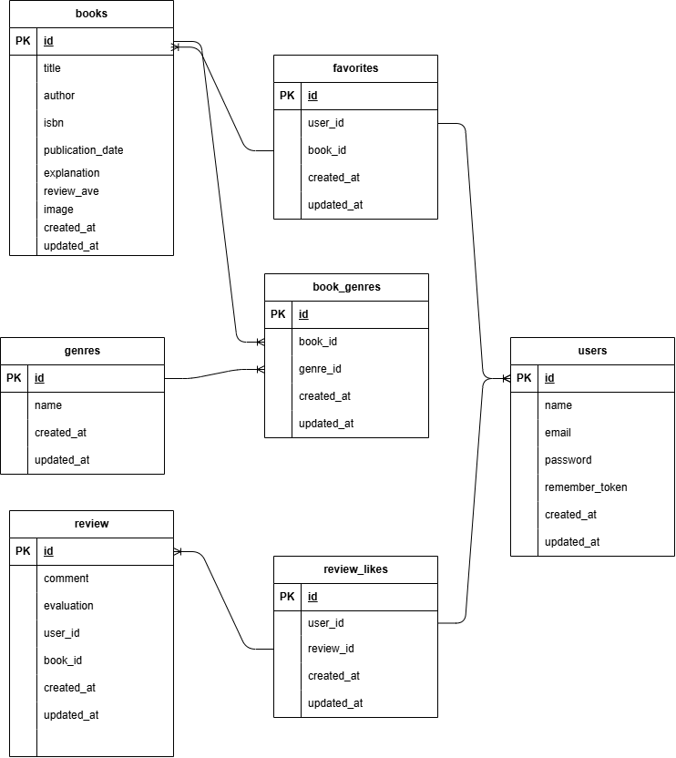

# Bookshelf

書籍管理アプリです。

## 概要

書籍の管理とレビュー投稿を行うWebアプリです。

## 環境構築

### 1 リポジトリをクローンする

今回はテストなので個人のリポジトリのurlを変更してください

```bash
git clone https://github.com/takahiro61202-cyber/bookshelf.git
```

```bash
cd bookshelf
```

### 2 Laravel Sailのインストール

```bash
docker run --rm -u "$(id -u):$(id -g)" -v "$(pwd):/var/www/html" -w /var/www/html -e COMPOSER_CACHE_DIR=/tmp/composer_cache laravelsail/php82-composer:latest composer require laravel/sail --dev

```

```bash
./vendor/bin/sail up -d
```

### 2 envファイルとアプリキーを作成してください

```bash
cp .env.example .env
```

```bash
sail artisan key:generate
```

### 5 envファイルの下記の欄を確認してください

```bash
DB_CONNECTION=mysql
DB_HOST=mysql
DB_PORT=3306
DB_DATABASE=laravel
DB_USERNAME=sail
DB_PASSWORD=password

```

### 6 Alpine.jsのインストール

```bash
sail npm install alpinejs
```

NPM依存パッケージのインストール
sail npm install

### 7 Vite開発サーバーの起動

sail npm run dev

### 6 マイグレーションを実施してください

```bash
./vendor/bin/sail artisan migrate
```

### 7 シーディング実施してください

```bash
./vendor/bin/sail artisan db:seed
```

## 使用技術(実装環境)

- PHP version 8.1.34
- Laravel Framework 8.83.29
- Composer version 2.9.5
- mysql from 11.8.3-MariaDB
- git version 2.43.0

## ER図



## URL

- 書籍一覧画面: http://localhost/
- ランキング画面: http://localhost/rankingm
- 書籍登録画面: http://localhost/register
- お気に入り登録画面: http://localhost/books/create
- ジャンル管理: http://localhost/favorites
- ログイン画面: http://localhost/login
- 会員登録画面: http://localhost/register
- phpMyAdmin: http://localhost:8080/
